<a href="https://www.ryantellissy.com/">
  <picture>
    <source media="(max-width: 600px)" srcset="https://raw.githubusercontent.com/RayenTellissy/RayenTellissy/main/assets/profile-narrow.svg">
    
  </picture>
</a>

[Website](https://www.ryantellissy.com/) · [LinkedIn](https://www.linkedin.com/in/ryantellissy/)

